# Introduzione

## Scopo del documento

Questo documento specifica i requisiti del sistema SideQuest, una piattaforma web per ideare, scoprire e completare piccole missioni sul territorio. È il primo artefatto del percorso anticipato di Ingegneria del Software (traccia, Appendice C, §C.6 punto 1 e §C.7). Serve a tre scopi:

- fissare con il Committente un'interpretazione unica e verificabile della traccia, che è volutamente incompleta (traccia §A.8);
- fornire la base per il design, l'implementazione e i test, che riportano gli stessi identificativi;
- rendere esplicite le assunzioni adottate per risolvere ambiguità e lacune.

Il documento potrà essere modificato nella consegna finale. Le modifiche saranno motivate nel registro del §10.

## Ambito e requisiti assegnati

Il gruppo è composto da tre studenti e segue il percorso anticipato, con identificativo 2627_008. L'ultima cifra è 8 e 8 mod 5 = 3, quindi il primo pacchetto è D; il secondo, in ordine ciclico, è E (traccia §5). L'ambito è quindi:

| Area | Requisiti | Contenuto |
|---|---|---|
| Nucleo comune | R01–R06 | Account e profilo, creazione e pubblicazione, esplorazione e ricerca, accettazione e missioni a tempo, progressi e prove, area personale e notifiche |
| Pacchetto D · Coinvolgimento | R16–R18 | Classifiche, badge e traguardi, statistiche personali |
| Pacchetto E · Esplorazione avanzata | R19–R21 | Percorsi di missioni, missioni vicine, arricchimento tramite API esterna |

I pacchetti A, B e C non sono assegnati. Dove un requisito assegnato tocca concetti di quei pacchetti (per esempio la moderazione), il documento lo dichiara e lo risolve con un'assunzione, senza introdurre funzioni non richieste.

## Riferimenti

- *SideQuest – Regole generali e specifiche del progetto*, A.A. 2026/2027 (di seguito "traccia").
- *SideQuest – Scelte architetturali*, Draft v1.0, e *Manifesto architetturale* del gruppo (`docs/MANIFESTO.md`): sono documenti di design, citati qui solo per coerenza tra le assunzioni.
- A. Cockburn, *Writing Effective Use Cases*, Addison-Wesley, 2001: template dei casi d'uso.

## Convenzioni

| Prefisso | Significato | Esempio |
|---|---|---|
| R | Requisito funzionale della traccia | R04 |
| UC | Caso d'uso: `UC-<requisito>.<progressivo>` | UC-04.1 |
| RNF | Requisito non funzionale | RNF-03 |
| RD | Requisito di dominio (regola di business) | RD-07 |
| A | Assunzione per un'ambiguità della traccia | A-03 |
| M | Mockup dell'interfaccia | M1 |

Nel testo "il Sistema" indica SideQuest nel suo insieme (SPA e back-end). I termini in corsivo sono definiti nel glossario.

# Glossario

| Termine | Definizione |
|---|---|
| Visitatore | Persona che usa SideQuest senza essersi autenticata. Può esplorare le missioni pubblicate ma non parteciparvi. |
| Utente registrato | Persona con un account attivo e autenticata. Ha un *profilo* e un'*area personale*. |
| Esploratore | Ruolo di un utente registrato che partecipa a una missione. |
| Autore | Ruolo di un utente registrato che ha creato una missione o un percorso. |
| Amministratore | Utente registrato con privilegi di gestione di utenti e contenuti. |
| Profilo | Dati personali dell'utente registrato: *nickname* (pubblico), email e informazioni personali (riservate). |
| Nickname | Nome pubblico e univoco con cui un utente compare nelle missioni e nelle classifiche. |
| Missione | Sfida creata da un autore: titolo, presentazione, categoria, obiettivi, eventuale luogo, modalità, difficoltà e condizioni di partecipazione. Ha un proprio ciclo di vita (RD-01). |
| Missione ordinaria | Missione i cui obiettivi sono visibili a tutti già prima dell'accettazione, senza limite di tempo per il singolo tentativo. |
| Missione segreta a tempo | Missione di cui, prima dell'accettazione, si vede solo l'*anteprima*. Gli obiettivi vengono svelati all'accettazione e da quel momento decorre una durata massima. |
| Anteprima | Informazioni pubbliche di una missione: titolo, presentazione, categoria, difficoltà, punti, durata, zona e numero di obiettivi. Non contiene mai il testo degli obiettivi di una missione segreta. |
| Obiettivo | Unità completabile di una missione. Può essere *autodichiarato* oppure *con prova*. |
| Prova | Breve testo o immagine che l'esploratore associa a un obiettivo con prova, soggetta a *verifica*. |
| Verifica | Decisione dell'autore (o di un amministratore) che approva o respinge una prova. |
| Tentativo | Partecipazione di un esploratore a una missione: nasce con l'accettazione e ha un proprio stato (RD-02). |
| Accettazione | Atto con cui un esploratore avvia un tentativo. Per le missioni segrete avvia anche il conto alla rovescia. |
| Scadenza | Istante, calcolato dal server al momento dell'accettazione, oltre il quale il tentativo è scaduto. |
| Ora del server | Ora di riferimento del Sistema. È l'unica usata per calcolare scadenze e tempo rimanente. |
| Esito | Stato finale di un tentativo: completata, abbandonata o scaduta. |
| Punti (XP) | Punteggio che l'esploratore riceve una sola volta per ogni tentativo completato. Il valore dipende dalla difficoltà della missione (RD-05). |
| Missione ritirata | Missione pubblicata che l'autore ha tolto dall'esplorazione: non accetta nuovi tentativi. |
| Missione invalidata | Missione che un amministratore ha dichiarato non valida. I suoi punti sono rimossi da classifiche, statistiche e badge (RD-09). |
| Classifica | Elenco ordinato degli utenti per punti o per missioni completate in un *periodo*. |
| Periodo | Intervallo di calendario su cui si calcola una classifica o una statistica: settimana, mese o da sempre (fuso Europe/Rome). |
| Badge | Riconoscimento virtuale assegnato automaticamente al verificarsi di una condizione pubblica e verificabile. |
| Statistiche personali | Dati aggregati sulle attività di un utente, visibili solo a lui. |
| Percorso | Sequenza ordinata di missioni pubblicate e tematicamente collegate, chiamate *tappe*. |
| Tappa | Missione in una posizione precisa di un percorso. |
| Missioni vicine | Missioni filtrate e ordinate per distanza da una posizione indicata dall'utente. |
| Zona approssimativa | Area circolare che contiene il luogo di una missione segreta senza rivelarne il punto esatto. |
| Approfondimento | Contenuto enciclopedico ottenuto da un servizio esterno (Wikipedia) e collegato a una missione. |
| Notifica | Messaggio persistente su un evento rilevante. Compare senza ricaricare la pagina e resta consultabile. |

# Utenti target e personas

## Utenti target

SideQuest si rivolge a persone maggiorenni che vogliono vivere il proprio territorio in modo attivo: studenti universitari, giovani lavoratori e turisti in città. Usano soprattutto lo smartphone mentre sono in movimento, e il computer per preparare missioni e consultare i propri risultati. Le competenze digitali attese sono quelle di chi usa comunemente app di mappe e social network. Non è richiesta alcuna competenza tecnica.

Gli utenti rientrano in tre gruppi, con bisogni diversi:

- **chi partecipa** (esploratori): cerca missioni brevi e vicine, deve capire prima di accettare quanto tempo e quale attrezzatura servono, e non vuole perdere i progressi;
- **chi crea** (autori): appassionati di cultura locale, guide e associazioni che preparano missioni e percorsi e verificano le prove;
- **chi gestisce** la piattaforma (amministratori): mantiene l'ordine con il minimo privilegio necessario e con decisioni tracciabili.

## Personas

Le personas sono archetipi fittizi costruiti dal gruppo a partire dalla traccia. Saranno validate con tre o quattro utenti reali prima della consegna finale.

```{=html}
<div class="personas">
<div class="persona">
  <p class="persona-name">Chiara, 22 anni</p>
  <p class="persona-role">Esploratrice · studentessa di Lettere a Napoli</p>
  <p><b>Contesto.</b> Usa quasi solo lo smartphone, spesso con connessione instabile. Ha mezz'ora libera tra una lezione e l'altra.</p>
  <p><b>Obiettivi.</b> Trovare missioni vicine e brevi; sapere prima di accettare quanto dureranno e cosa serve.</p>
  <p><b>Frustrazioni.</b> Perdere i progressi se il browser si chiude; timer che "barano" o che ripartono.</p>
  <p><b>Requisiti chiave.</b> R03, R04, R05, R20.</p>
</div>
<div class="persona">
  <p class="persona-name">Marco, 47 anni</p>
  <p class="persona-role">Autore · guida turistica e volontario di un'associazione culturale</p>
  <p><b>Contesto.</b> Prepara le missioni al computer la sera; non è un esperto di strumenti digitali.</p>
  <p><b>Obiettivi.</b> Creare missioni e percorsi a tema sul centro storico, verificare le prove in poco tempo, arricchire le missioni con informazioni storiche affidabili.</p>
  <p><b>Frustrazioni.</b> Regole poco chiare su cosa può modificare dopo la pubblicazione; contestazioni sulle prove.</p>
  <p><b>Requisiti chiave.</b> R02, R05, R19, R21.</p>
</div>
<div class="persona">
  <p class="persona-name">Davide, 29 anni</p>
  <p class="persona-role">Esploratore competitivo · sviluppatore, fa sport all'aperto nel weekend</p>
  <p><b>Contesto.</b> Partecipa con costanza e confronta i risultati con gli amici.</p>
  <p><b>Obiettivi.</b> Scalare la classifica settimanale, collezionare badge, vedere i propri progressi nel tempo.</p>
  <p><b>Frustrazioni.</b> Classifiche falsate da missioni annullate o truccate; condizioni dei badge poco chiare.</p>
  <p><b>Requisiti chiave.</b> R06, R16, R17, R18.</p>
</div>
<div class="persona">
  <p class="persona-name">Sara, 35 anni</p>
  <p class="persona-role">Amministratrice della piattaforma</p>
  <p><b>Contesto.</b> Dedica a SideQuest poche ore a settimana, da computer.</p>
  <p><b>Obiettivi.</b> Gestire gli account problematici e invalidare le missioni fraudolente, con effetti chiari e tracciati.</p>
  <p><b>Frustrazioni.</b> Vedere dati personali che non le servono; non sapere quali effetti avrà un'invalidazione.</p>
  <p><b>Requisiti chiave.</b> R01, R16.</p>
</div>
</div>
```

## Attori

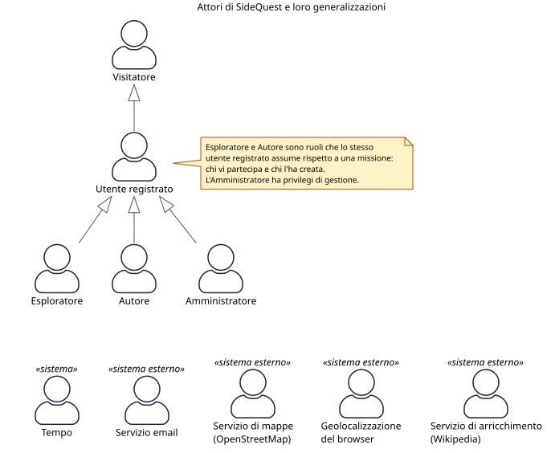{.diagram-small}

| Attore | Tipo | Descrizione |
|---|---|---|
| Visitatore | Primario, umano | Usa la piattaforma senza account: esplora missioni, percorsi e classifiche, si registra e accede. |
| Utente registrato | Primario, umano | Eredita i casi d'uso del visitatore; gestisce profilo, area personale e notifiche. |
| Esploratore | Primario, ruolo | Utente registrato che accetta e svolge una missione. |
| Autore | Primario, ruolo | Utente registrato che crea, pubblica e ritira missioni, verifica le prove, compone percorsi. |
| Amministratore | Primario, umano | Utente registrato con privilegi: gestisce gli utenti e può invalidare missioni. |
| Tempo | Secondario, sistema | Fa scattare la scadenza dei tentativi quando l'ora del server supera la scadenza. |
| Servizio email | Secondario, esterno | Consegna i link di verifica dell'indirizzo email. |
| Servizio di mappe | Secondario, esterno | Fornisce le tessere cartografiche OpenStreetMap, con attribuzione. |
| Geolocalizzazione del browser | Secondario, esterno | Fornisce la posizione corrente, solo previo consenso dell'utente. |
| Servizio di arricchimento | Secondario, esterno | Wikipedia in italiano: fornisce sintesi enciclopediche per le missioni. |

# Requisiti funzionali e casi d'uso

## Dai requisiti ai casi d'uso

Ogni requisito assegnato è stato scomposto in casi d'uso a livello di obiettivo utente. La tabella riassume la corrispondenza; il §9 riporta la matrice di tracciabilità completa.

| Requisito | Casi d'uso |
|---|---|
| R01 Account, accesso e profilo | UC-01.1 – UC-01.8 |
| R02 Creazione e pubblicazione | UC-02.1 – UC-02.5 |
| R03 Esplorazione e ricerca | UC-03.1 – UC-03.4 |
| R04 Accettazione e missioni a tempo | UC-04, UC-04.1, UC-04.2, UC-04.3 |
| R05 Progressi, prove e completamento | UC-05.1 – UC-05.5 |
| R06 Area personale e notifiche | UC-06.1 – UC-06.3 |
| R16 Classifiche | UC-16.1, UC-16.2 |
| R17 Badge e traguardi | UC-17.1, UC-17.2 |
| R18 Statistiche personali | UC-18.1 |
| R19 Percorsi di missioni | UC-19.1 – UC-19.4 |
| R20 Missioni vicine | UC-20.1 – UC-20.3 |
| R21 Arricchimento tramite API esterna | UC-21.1, UC-21.2 |

## R01 · Account, accesso, profilo e amministrazione

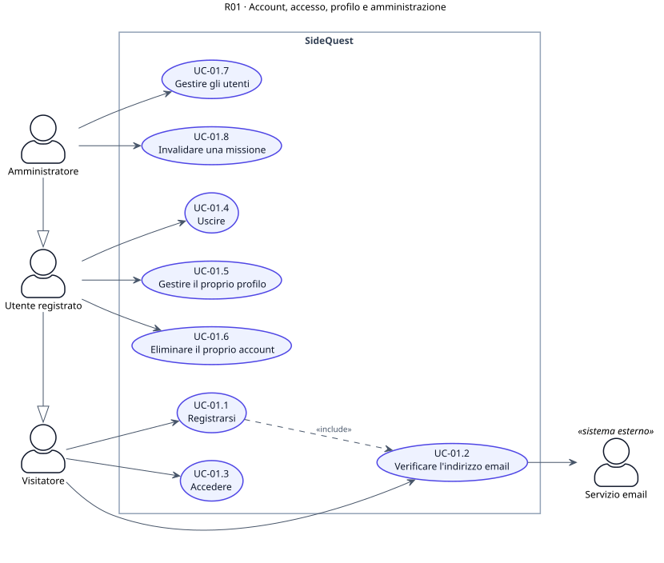

| ID | Caso d'uso | Attore primario | Descrizione breve |
|---|---|---|---|
| UC-01.1 | Registrarsi | Visitatore | Crea un account con nickname, email e password; include l'invio del link di verifica. |
| UC-01.2 | Verificare l'indirizzo email | Visitatore | Apre il link ricevuto (monouso, valido 24 ore) e conferma l'indirizzo. Può richiedere un nuovo link. |
| UC-01.3 | Accedere | Visitatore | Si autentica con email e password; la sessione resta attiva tra una visita e l'altra. |
| UC-01.4 | Uscire | Utente registrato | Termina la sessione sul dispositivo in uso. |
| UC-01.5 | Gestire il proprio profilo | Utente registrato | Consulta e modifica nickname e informazioni personali. |
| UC-01.6 | Eliminare il proprio account | Utente registrato | Elimina l'account e chiude tutte le sessioni attive (RD-12). |
| UC-01.7 | Gestire gli utenti | Amministratore | Cerca utenti, ne cambia il ruolo, li sospende o li elimina. |
| UC-01.8 | Invalidare una missione | Amministratore | Dichiara non valida una missione, con motivazione; i suoi effetti su punti e badge vengono rettificati (RD-09). |

## R02–R03 · Creazione, pubblicazione ed esplorazione delle missioni

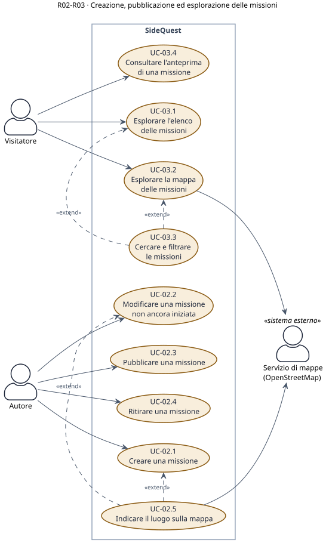

| ID | Caso d'uso | Attore primario | Descrizione breve |
|---|---|---|---|
| UC-02.1 | Creare una missione | Autore | Prepara una bozza con titolo, presentazione, categoria, obiettivi, difficoltà, modalità (ordinaria o segreta con durata) e condizioni di partecipazione. |
| UC-02.2 | Modificare una missione non ancora iniziata | Autore | Modifica una bozza, oppure una missione pubblicata che non ha ancora tentativi (A-01). |
| UC-02.3 | Pubblicare una missione | Autore | Rende visibile la missione dopo il controllo di completezza (RD-01). |
| UC-02.4 | Ritirare una missione | Autore | Toglie la missione dall'esplorazione; i tentativi in corso proseguono (RD-08). |
| UC-02.5 | Indicare il luogo sulla mappa | Autore | Estende la creazione e la modifica: posiziona la missione sulla mappa. |
| UC-03.1 | Esplorare l'elenco delle missioni | Visitatore | Scorre le missioni pubblicate con le informazioni di anteprima. |
| UC-03.2 | Esplorare la mappa delle missioni | Visitatore | Vede le missioni georeferenziate su una mappa interattiva; quelle segrete compaiono come zona approssimativa. |
| UC-03.3 | Cercare e filtrare le missioni | Visitatore | Filtra per parole chiave, categoria e stato di disponibilità; estende elenco e mappa. |
| UC-03.4 | Consultare l'anteprima di una missione | Visitatore | Apre il dettaglio pubblico di una missione, senza gli obiettivi se è segreta. |

## R04–R05 · Accettazione, progressi, prove e completamento

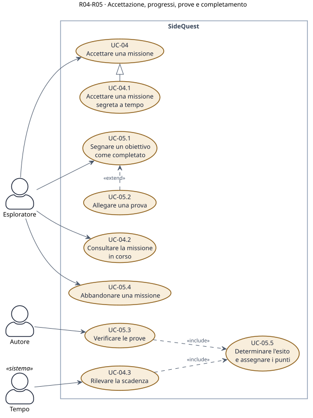

| ID | Caso d'uso | Attore primario | Descrizione breve |
|---|---|---|---|
| UC-04 | Accettare una missione | Esploratore | Avvia un tentativo su una missione disponibile. |
| UC-04.1 | Accettare una missione segreta a tempo | Esploratore | Specializza UC-04: svela gli obiettivi e avvia il conto alla rovescia calcolato dal server. **Formalizzato al §8.** |
| UC-04.2 | Consultare la missione in corso | Esploratore | Vede obiettivi, progressi e tempo rimanente, anche dopo una ricarica o da un altro dispositivo. |
| UC-04.3 | Rilevare la scadenza | Tempo | Allo scadere del tempo il tentativo diventa scaduto e l'esploratore viene notificato. |
| UC-05.1 | Segnare un obiettivo come completato | Esploratore | Indica un obiettivo come concluso. |
| UC-05.2 | Allegare una prova | Esploratore | Estende UC-05.1 per gli obiettivi con prova: allega un testo o un'immagine. |
| UC-05.3 | Verificare le prove | Autore | Approva o respinge con motivazione le prove ricevute; include la determinazione dell'esito. |
| UC-05.4 | Abbandonare una missione | Esploratore | Rinuncia al tentativo in modo definitivo e senza punti (A-05). |
| UC-05.5 | Determinare l'esito e assegnare i punti | Sistema (incluso) | Stabilisce se il tentativo è completato, abbandonato o scaduto e accredita i punti una sola volta. |

## R06 e pacchetto D · Area personale, notifiche, classifiche, badge e statistiche

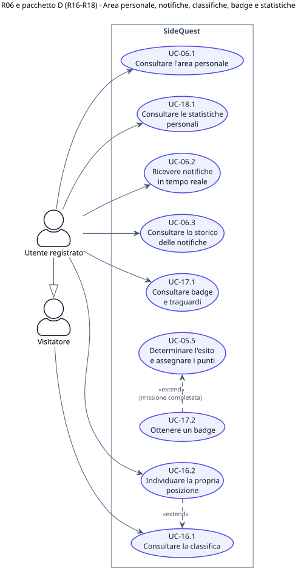

| ID | Caso d'uso | Attore primario | Descrizione breve |
|---|---|---|---|
| UC-06.1 | Consultare l'area personale | Utente registrato | Vede le missioni create e quelle a cui partecipa, ciascuna con il proprio stato. |
| UC-06.2 | Ricevere notifiche in tempo reale | Utente registrato | Riceve senza ricaricare la pagina le notifiche su accettazioni, cambi di stato ed esiti delle verifiche. |
| UC-06.3 | Consultare lo storico delle notifiche | Utente registrato | Rilegge le notifiche passate e le segna come lette. |
| UC-16.1 | Consultare la classifica | Visitatore | Sceglie criterio (punti o missioni completate) e periodo (settimana, mese, da sempre). |
| UC-16.2 | Individuare la propria posizione | Utente registrato | Estende UC-16.1: evidenzia la propria posizione anche se fuori dai primi 50. |
| UC-17.1 | Consultare badge e traguardi | Utente registrato | Vede il catalogo dei badge con condizioni e progresso personale. |
| UC-17.2 | Ottenere un badge | Utente registrato | Estende UC-05.5: quando una condizione si verifica il badge viene assegnato e notificato. |
| UC-18.1 | Consultare le statistiche personali | Utente registrato | Vede missioni completate, tentativi falliti, tempo medio, categorie preferite e punti nel tempo. |

## Pacchetto E · Percorsi, missioni vicine e arricchimento esterno

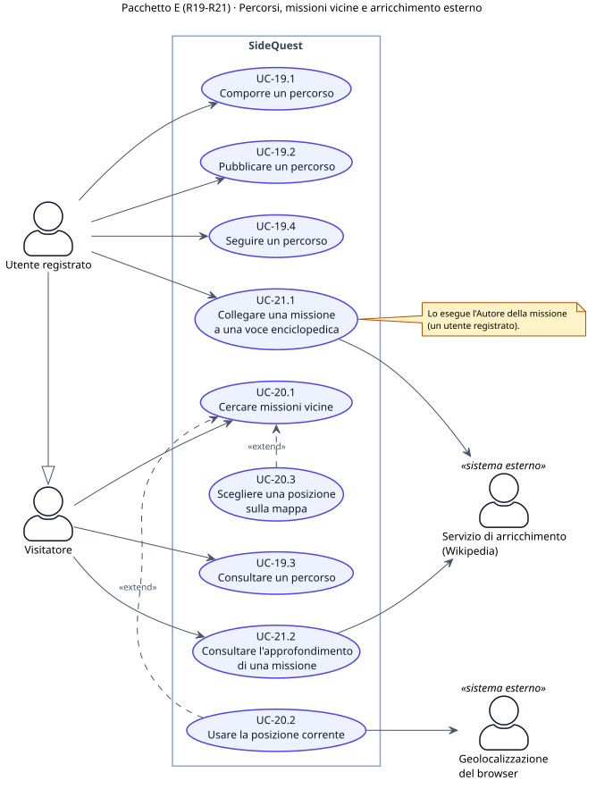

| ID | Caso d'uso | Attore primario | Descrizione breve |
|---|---|---|---|
| UC-19.1 | Comporre un percorso | Utente registrato | Sceglie da 2 a 10 missioni pubblicate, le ordina e descrive il tema. |
| UC-19.2 | Pubblicare un percorso | Utente registrato | Rende il percorso consultabile da tutti. |
| UC-19.3 | Consultare un percorso | Visitatore | Vede l'ordine delle tappe e le condizioni per passare alla successiva. |
| UC-19.4 | Seguire un percorso | Utente registrato | Si iscrive al percorso e ne vede il progresso complessivo; la tappa successiva si sblocca col completamento della precedente. |
| UC-20.1 | Cercare missioni vicine | Visitatore | Ordina e filtra le missioni per distanza da una posizione. |
| UC-20.2 | Usare la posizione corrente | Visitatore | Estende UC-20.1 con la geolocalizzazione del browser, previo consenso. |
| UC-20.3 | Scegliere una posizione sulla mappa | Visitatore | Estende UC-20.1 quando la geolocalizzazione è negata o non disponibile. |
| UC-21.1 | Collegare una missione a una voce enciclopedica | Autore | Cerca su Wikipedia e associa una voce alla propria missione. |
| UC-21.2 | Consultare l'approfondimento di una missione | Visitatore | Legge sintesi, immagine e collegamento alla voce, con attribuzione. |

# Requisiti non funzionali

Ogni requisito ha un criterio di verifica, così da poterlo collegare a un test.

| ID | Categoria | Requisito | Verifica |
|---|---|---|---|
| RNF-01 | Sicurezza | Le password sono di almeno 12 caratteri, con minuscole, maiuscole, cifre e simboli, e sono memorizzate solo come hash Argon2id. | Test di validazione; ispezione dello schema dati. |
| RNF-02 | Sicurezza | Ogni operazione riservata è autorizzata dal back-end in base a identità, ruolo e proprietà della risorsa; l'interfaccia nasconde solo per comodità. | Test API: 401 senza sessione, 403 con utente non autorizzato, per ogni endpoint non pubblico. |
| RNF-03 | Sicurezza | Gli obiettivi di una missione segreta non lasciano mai il server prima dell'accettazione: né nelle risposte, né negli eventi, né nei log. | Test API sul contenuto delle risposte pubbliche e dell'anteprima. |
| RNF-04 | Sicurezza | Le credenziali di sessione non sono accessibili a JavaScript; le richieste che modificano dati sono protette da CSRF; gli accessi sono limitati in frequenza. | Test di integrazione; ispezione degli header. |
| RNF-05 | Riservatezza | Sono pubblici solo nickname, missioni pubblicate, percorsi, badge e posizione in classifica. Email, informazioni personali, statistiche e posizione geografica dell'utente restano private. | Test API da visitatore e da utente terzo. |
| RNF-06 | Affidabilità del tempo | Scadenza e tempo rimanente si calcolano solo sull'ora del server. Ricaricare la pagina, cambiare dispositivo o alterare l'orologio locale non allunga la durata. Lo scarto mostrato è al massimo di 1 s dopo ogni risincronizzazione. | Test con orologio iniettato e con client dall'orologio spostato. |
| RNF-07 | Integrità | Due richieste concorrenti di accettazione dello stesso utente producono al più un tentativo. Ripetere una richiesta interrotta non crea duplicati. | Test di concorrenza con richieste simultanee. |
| RNF-08 | Notifiche | Una notifica compare nell'interfaccia entro 2 s dall'evento, senza ricaricare la pagina. Dopo una disconnessione, le notifiche perse vengono recuperate. | Test E2E con riconnessione simulata. |
| RNF-09 | Usabilità | Tutti i flussi sono utilizzabili da 360 px a 1440 px di larghezza, con mouse, tastiera e touch. L'interfaccia rispetta WCAG 2.1 livello AA. | Test E2E su due viewport; analisi automatica con axe. |
| RNF-10 | Usabilità | Gli errori sono comprensibili: ogni errore dice cosa è successo e cosa si può fare. Gli errori di rete propongono di riprovare senza perdere i dati inseriti. | Revisione dei mockup; test E2E dei casi negativi. |
| RNF-11 | Prestazioni | Con il database dimostrativo, il 95% delle letture risponde entro 300 ms e la ricerca di missioni vicine entro 500 ms, misurati sul server. | Misura con dati di seed. |
| RNF-12 | Robustezza | Se il servizio di arricchimento è lento (oltre 3 s) o non disponibile, la missione resta consultabile e accettabile; l'approfondimento mostra un messaggio. | Test con servizio esterno simulato che risponde 503 o va in timeout. |
| RNF-13 | Dimostrabilità | Tutti i flussi sono dimostrabili senza spostamenti fisici e senza servizi esterni: posizione scelta su mappa, prove simulate, email scritte nel log. | Esecuzione della demo in locale. |
| RNF-14 | Portabilità | Il sistema si avvia con un solo comando di Docker Compose, con dati e account dimostrativi. | Avvio da un clone pulito su una seconda macchina. |
| RNF-15 | Compatibilità | Funziona sulle ultime due versioni di Chrome, Firefox, Safari ed Edge, desktop e mobile. | Test E2E su Chromium, Firefox e WebKit. |
| RNF-16 | Conformità | La mappa mostra l'attribuzione di OpenStreetMap; l'approfondimento mostra l'attribuzione di Wikipedia (CC BY-SA). L'uso dei servizi rispetta i loro limiti e le loro condizioni. | Revisione dell'interfaccia. |
| RNF-17 | Localizzazione | L'interfaccia è in italiano; date e orari sono nel fuso Europe/Rome. | Revisione dell'interfaccia. |

# Requisiti di dominio

| ID | Regola |
|---|---|
| RD-01 | **Ciclo di vita della missione.** Una missione nasce come *bozza*, visibile solo all'autore. Diventa *pubblicata* solo se ha titolo, presentazione, categoria, difficoltà e da 1 a 10 obiettivi; le missioni segrete devono avere una durata tra 5 e 240 minuti. Una missione pubblicata può essere *ritirata* dall'autore o *invalidata* da un amministratore. Una bozza si può eliminare. |
| RD-02 | **Ciclo di vita del tentativo.** Un tentativo nasce *in corso* all'accettazione. Diventa *in verifica* quando tutti gli obiettivi sono segnati e almeno una prova attende verifica. Termina in uno di tre esiti: *completata*, *abbandonata* o *scaduta*. Gli esiti sono definitivi. |
| RD-03 | **Disponibilità.** Una missione è disponibile per un utente se è pubblicata, non ritirata né invalidata, è dentro la propria finestra di disponibilità (se l'autore l'ha impostata) e l'utente non ne è l'autore né ha già un tentativo su di essa. |
| RD-04 | **Completamento.** Un tentativo è completato quando tutti gli obiettivi sono segnati entro la scadenza e tutte le prove richieste sono approvate. Una prova respinta riporta il suo obiettivo da completare; se intanto la scadenza è passata, il tentativo è scaduto. |
| RD-05 | **Punti.** I punti dipendono dalla difficoltà fissata alla pubblicazione: facile 60, media 120, difficile 200. Sono accreditati una sola volta, quando il tentativo diventa completato. Tentativi abbandonati o scaduti valgono 0. |
| RD-06 | **Scadenza.** Per una missione segreta, scadenza = istante di accettazione + durata, entrambi letti dall'orologio del server. Un'azione ricevuta in un istante maggiore o uguale alla scadenza è fuori tempo (A-03). Per una missione ordinaria il tentativo scade solo alla fine della finestra di disponibilità, se impostata. |
| RD-07 | **Verifica.** Solo l'autore della missione, o un amministratore, può verificare le prove. Respingere una prova richiede una motivazione. |
| RD-08 | **Ritiro.** Una missione ritirata non accetta nuovi tentativi e non compare nell'esplorazione. I tentativi in corso proseguono fino all'esito; i punti già ottenuti restano validi. |
| RD-09 | **Invalidazione.** Un amministratore invalida una missione con una motivazione registrata. I tentativi in corso terminano senza punti. I punti già ottenuti con quella missione sono tolti da classifiche e statistiche, i badge non più giustificati vengono revocati e gli utenti coinvolti ricevono una notifica. |
| RD-10 | **Classifiche.** Due criteri: punti, oppure numero di missioni completate. Tre periodi di calendario nel fuso Europe/Rome: settimana corrente (da lunedì), mese corrente, da sempre. Contano solo i tentativi completati nel periodo e non invalidati. A parità di valore gli utenti hanno la stessa posizione (1, 2, 2, 4). Si mostrano i primi 50 e la posizione dell'utente autenticato. |
| RD-11 | **Badge.** Il catalogo iniziale ha condizioni pubbliche e verificabili sui soli tentativi completati e non invalidati: *Primi passi* (1 missione completata), *Esploratore* (10), *Poliedrico* (missioni completate in 3 categorie diverse), *Costante* (almeno una missione completata in 4 settimane consecutive), *Contro il tempo* (5 missioni segrete a tempo completate), *Viandante* (1 percorso completato). Ogni badge si ottiene una sola volta. |
| RD-12 | **Eliminazione dell'account.** Eliminare l'account chiude tutte le sessioni e rende anonimi i contenuti pubblicati (autore "utente eliminato"). Le missioni dell'utente vengono ritirate e i suoi tentativi in corso abbandonati. Le classifiche non mostrano più l'utente. |
| RD-13 | **Statistiche personali.** Comprendono: missioni completate; tentativi falliti (abbandonati più scaduti); tempo medio di completamento (dall'accettazione all'ultimo obiettivo segnato); le tre categorie con più missioni completate; punti per settimana nelle ultime 12 settimane. Escludono le missioni invalidate. |
| RD-14 | **Percorsi.** Un percorso ha da 2 a 10 tappe, tutte missioni pubblicate, anche di altri autori. La tappa k si sblocca quando la tappa k−1 è completata. Il progresso è il rapporto tra tappe completate e tappe valide. Un percorso è completato quando tutte le tappe valide sono completate. |
| RD-15 | **Missioni vicine.** La distanza è quella geodetica dal luogo della missione o, per le segrete, dal centro della zona approssimativa. Si escludono le missioni senza luogo. Raggi selezionabili: 1, 5, 10 e 25 km, predefinito 5 km. Il risultato è ordinato per distanza crescente. |
| RD-16 | **Zona approssimativa.** Prima dell'accettazione, il luogo di una missione segreta si mostra come un cerchio di 300 m di raggio che contiene il punto esatto, senza che questo ne sia il centro. Il punto esatto si vede solo dopo l'accettazione. |
| RD-17 | **Approfondimento.** Una missione può essere collegata a una sola voce di Wikipedia in italiano. Il Sistema mostra sintesi, eventuale immagine, collegamento alla voce e attribuzione CC BY-SA. I contenuti sono conservati per 24 ore. |

# Assunzioni

La traccia è volutamente incompleta (traccia §A.1 e §A.8). Le assunzioni seguenti risolvono le ambiguità rilevanti per i requisiti assegnati. Per ciascuna è indicata l'alternativa scartata, per renderne esplicita la motivazione. Le assunzioni A-01 … A-14 riprendono la numerazione del documento *Scelte architetturali*; A-10 … A-13 riguardano pacchetti non assegnati e sono omesse.

| ID | Ambiguità | Decisione | Alternativa scartata e motivo | Req. |
|---|---|---|---|---|
| A-01 | Cosa si può modificare dopo la pubblicazione? | Tutto, finché la missione non ha tentativi. Dopo il primo tentativo si può solo ritirarla; per cambiarla si crea una nuova missione. | Modifica libera: chi partecipa vedrebbe cambiare gli obiettivi durante il tentativo. | R02 |
| A-02 | Quanti tentativi per utente e missione? | Uno solo, non ripetibile dopo un esito. | Più tentativi: complica punti, classifiche e prove già viste. | R04, R05, R16 |
| A-03 | Un'azione al limite della scadenza è in tempo? | Conta l'istante di ricezione sul server; un'azione ricevuta esattamente alla scadenza è fuori tempo. Una prova ricevuta in tempo resta valida anche se verificata dopo. | Periodo di tolleranza: sposta solo il confine e va comunque documentato. | R04, R05 |
| A-04 | Chi verifica le prove? | Gli obiettivi sono autodichiarati oppure con prova. Le prove le verifica l'autore o, in sua assenza, un amministratore. L'autore non può partecipare alle proprie missioni. | Solo autodichiarazione: veloce ma poco credibile per le foto. | R05 |
| A-05 | Si può abbandonare e riprendere? | L'abbandono è definitivo, senza punti, e genera una notifica all'autore. | Pausa e ripresa: aggirerebbe il timer. | R05 |
| A-06 | Quando si riconosce una scadenza? | A ogni lettura e scrittura del tentativo, più un controllo periodico che chiude i tentativi scaduti e invia le notifiche. | Solo controllo periodico: per un intervallo lo stato mostrato sarebbe incoerente. | R04 |
| A-07 | Quali dati degli utenti sono pubblici? | Solo nickname, badge e posizione in classifica. | Profilo pubblico configurabile: più interfaccia e più regole senza un requisito che lo chieda. | R01, R16, R18 |
| A-08 | Come si calcolano i punti? | Valore fisso per difficoltà, fissato alla pubblicazione e accreditato una volta (RD-05). | Punti variabili per tempo impiegato: meno spiegabili e più contestabili. | R05, R16 |
| A-09 | Cosa succede ai risultati di una missione rimossa? | Ritiro e invalidazione sono distinti (RD-08, RD-09); nessuna cancellazione fisica dei tentativi. | Cancellazione fisica: si perde lo storico e la rettifica non è tracciabile. | R02, R16 |
| A-14 | Cosa succede se l'API esterna non risponde? | L'approfondimento è facoltativo: la missione funziona senza e l'interfaccia mostra un avviso. | Errore bloccante: dipendenza esterna non necessaria. | R21 |
| A-15 | La traccia cita funzioni di moderazione, ma il pacchetto C non è assegnato. | L'unica funzione sui contenuti è l'invalidazione da parte dell'amministratore (UC-01.8), necessaria per la coerenza delle classifiche (R16). Segnalazioni, decisioni motivate e contestazioni non sono previste. | Implementare la moderazione completa: fuori dall'ambito assegnato. | R01, R16 |
| A-16 | A parità di punteggio chi viene prima? | Stessa posizione per valori uguali (1, 2, 2, 4). | Spareggio per data: premia chi arriva prima, un criterio non richiesto. | R16 |
| A-17 | I badge si possono perdere? | Solo per invalidazione di una missione che li giustificava (RD-09). | Badge irrevocabili: classifiche e badge diventerebbero incoerenti tra loro. | R17 |
| A-18 | Le statistiche di un utente sono visibili ad altri? | No, nemmeno agli amministratori. | Statistiche pubbliche: esporrebbero abitudini e orari degli utenti. | R18 |
| A-19 | Cosa succede a un percorso se una tappa fallisce? | Il percorso non può più essere completato, perché ogni missione ammette un solo tentativo (A-02); il progresso resta visibile. | Tappa ripetibile: in contrasto con A-02. | R19 |
| A-20 | Cosa succede a un percorso se una tappa viene ritirata o invalidata? | La tappa diventa non valida e non conta nel progresso; chi segue il percorso viene avvisato. | Percorso bloccato: punirebbe chi lo segue per una scelta altrui. | R19 |
| A-21 | La posizione dell'utente viene salvata? | No: si usa solo per la singola ricerca e non viene registrata. | Salvarla per proporre missioni: un dato sensibile senza un requisito che lo chieda. | R20 |
| A-22 | Il luogo di una missione segreta può rivelarne gli obiettivi? | Prima dell'accettazione si mostra solo la zona approssimativa (RD-16). | Punto esatto: potrebbe svelare la soluzione. | R03, R04 |
| A-23 | Quale servizio esterno e con quale utilità? | Wikipedia in italiano (API REST pubblica): dà all'esploratore il contesto storico e culturale del luogo, utile a risolvere e apprezzare la missione. Le richieste si identificano con uno User-Agent come chiede Wikimedia. | Servizi a pagamento o con chiave: rendono la demo dipendente da credenziali. | R21 |
| A-24 | Cosa sono le "condizioni di partecipazione"? | Una finestra di disponibilità facoltativa (inizio e fine) e note libere sull'attrezzatura necessaria. | Requisiti di livello o di punteggio: introducono regole non richieste. | R02 |

# Caso d'uso formalizzato: UC-04.1

Per la consegna anticipata è richiesto almeno un caso d'uso formalizzato, escluse registrazione e autenticazione (traccia §C.6, 1.e). Abbiamo scelto UC-04.1 perché concentra le regole più delicate del nucleo: segreti che non devono trapelare, tempo deciso dal server, unicità del tentativo con richieste concorrenti o ripetute.

## Descrizione testuale (template di Cockburn)

Le tabelle dei flussi hanno una colonna per l'attore principale, una per l'attore secondario e una per il Sistema. Ogni riga è un passo e la cella di chi agisce descrive l'azione, con il dettaglio utile all'implementazione. Le etichette <span class="mk">M1</span>…<span class="mk">M8</span> rimandano ai mockup del §8.2; gli identificativi RD, RNF e A rimandano ai §5–7.

```{=html}
<table class="uc-head">
<tr><th>Caso d'uso</th><td><b>UC-04.1 – Accettare una missione segreta a tempo</b></td></tr>
<tr><th>Requisiti</th><td>R04 (principale); R03 per l'anteprima, R05 per la prosecuzione, R06 per la notifica all'autore.</td></tr>
<tr><th>Obiettivo nel contesto</th><td>L'Esploratore, dopo aver letto l'anteprima di una missione segreta a tempo, decide di accettarla per scoprirne gli obiettivi e completarla entro la durata prevista, che decorre dall'accettazione.</td></tr>
<tr><th>Portata</th><td>SideQuest (SPA e back-end), considerato come scatola nera.</td></tr>
<tr><th>Livello</th><td>Obiettivo utente (user goal).</td></tr>
<tr><th>Attore principale</th><td>Esploratore: utente registrato e autenticato che partecipa alla missione.</td></tr>
<tr><th>Attori secondari</th><td>Tempo: l'orologio del server. Interviene solo quando la scadenza viene raggiunta (estensione 7b).</td></tr>
<tr><th>Stakeholder e interessi</th><td>
<b>Esploratore:</b> capire prima di accettare cosa lo aspetta; avere tutto il tempo promesso, né più né meno; non perdere il tentativo se la rete cade o il browser si chiude.<br>
<b>Autore:</b> gli obiettivi restano segreti fino all'accettazione; sapere chi ha accettato la sua missione.<br>
<b>Altri esploratori:</b> nessuno ottiene più tempo o un secondo tentativo, così punti e classifiche (R16) restano equi.<br>
<b>Amministratore:</b> stato coerente e tracciabile anche in caso di guasti o richieste ripetute.</td></tr>
<tr><th>Precondizioni</th><td>La missione esiste ed è di tipo segreto a tempo. L'Esploratore sta consultando la sua anteprima (UC-03.4).</td></tr>
<tr><th>Condizione finale di successo</th><td>Esiste uno e un solo tentativo dell'Esploratore sulla missione, nello stato «In corso», con istante di accettazione e scadenza registrati secondo l'ora del server. Gli obiettivi sono visibili solo all'Esploratore. L'Autore ha ricevuto una notifica.</td></tr>
<tr><th>Condizione finale di fallimento</th><td>Non esiste alcun nuovo tentativo; un eventuale tentativo precedente resta invariato, con la sua scadenza. Gli obiettivi non sono stati inviati al client.</td></tr>
<tr><th>Evento scatenante</th><td>L'Esploratore preme «Accetta missione» nella pagina «Dettaglio missione» di una missione segreta a tempo.</td></tr>
</table>
```

### Scenario principale di successo

```{=html}
<table class="uc-flow">
<thead><tr><th class="c-step">Passo</th><th>Esploratore<br><span>attore principale</span></th><th class="c-sec">Tempo<br><span>attore secondario</span></th><th>Sistema</th></tr></thead>
<tr><td>1</td><td>Dall'elenco, dalla mappa o da un percorso apre una missione contrassegnata dal badge «Segreta a tempo».</td><td></td><td></td></tr>
<tr><td>2</td><td></td><td></td><td>Legge la missione e controlla che sia pubblicata e visibile. Mostra la pagina «Dettaglio missione» <span class="mk">M1</span>: badge «Segreta a tempo», categoria e punti; titolo e presentazione; le schede «Durata», «Zona» e «Autore»; una mappa OpenStreetMap con la zona approssimativa (RD-16); il riquadro «Gli obiettivi si svelano dopo l'accettazione», che ricorda la durata e spiega che il tempo è calcolato dal server; l'elenco «N obiettivi» con le tappe bloccate e senza testo.<br>La risposta del server non contiene né il testo degli obiettivi né il punto esatto (RNF-03, A-22). In fondo alla pagina, fisso, il pulsante «Accetta missione».</td></tr>
<tr><td>3</td><td>Preme «Accetta missione».</td><td></td><td></td></tr>
<tr><td>4</td><td></td><td></td><td>Senza contattare il server, apre il pannello «Avviare la missione?» <span class="mk">M2</span> con tre regole: il timer della durata indicata parte subito e non si mette in pausa; ricaricare la pagina o cambiare dispositivo non aggiunge tempo; si può abbandonare in qualsiasi momento, ma senza punti. Mostra i pulsanti «Annulla» e «Accetta e avvia» e genera una chiave di idempotenza valida per questa sola conferma.</td></tr>
<tr><td>5</td><td>Legge le regole e preme «Accetta e avvia».</td><td></td><td></td></tr>
<tr><td>6</td><td></td><td></td><td>Invia la richiesta di accettazione con la chiave di idempotenza e disabilita il pulsante, mostrando un indicatore di attesa.<br>Sul server, in un'unica transazione: autentica l'Esploratore; verifica la disponibilità della missione per lui (RD-03); legge l'ora del server <i>T</i>; crea il tentativo nello stato «In corso» con accettazione <i>T</i> e scadenza <i>T</i> + durata (RD-06); associa la chiave di idempotenza alla risposta; registra l'evento «missione accettata», da cui nasce la notifica all'Autore (R06). Il vincolo di unicità del tentativo per Esploratore e missione impedisce un secondo tentativo anche con richieste concorrenti (RNF-07).<br>Risponde con identificativo del tentativo, obiettivi ora svelati, scadenza e ora del server.</td></tr>
<tr><td>7</td><td></td><td></td><td>Apre la pagina «Missione in corso» <span class="mk">M3</span>: badge «In corso»; riquadro «Tempo rimanente» con il conto alla rovescia in minuti e secondi, una barra di avanzamento e la riga «Scade alle hh:mm · orario del server»; elenco «Obiettivi · 0 di N» con gli obiettivi svelati; pulsanti «Aggiungi prova» e «Abbandona missione».<br>Il tempo rimanente è calcolato come scadenza meno l'ora del server stimata: il client misura lo scarto tra il proprio orologio e l'ora ricevuta e lo corregge a ogni risincronizzazione (RNF-06). L'Autore riceve la notifica «&lt;nickname&gt; ha accettato &lt;titolo&gt;» senza ricaricare la pagina.</td></tr>
</table>
```

Il caso d'uso termina con successo; l'Esploratore prosegue con UC-05.1 *Segnare un obiettivo come completato*.

### Estensioni

```{=html}
<table class="uc-flow">
<thead><tr><th class="c-step">Passo</th><th>Esploratore<br><span>attore principale</span></th><th class="c-sec">Tempo<br><span>attore secondario</span></th><th>Sistema</th></tr></thead>
<tr class="cond"><td>2a</td><td colspan="3"><b>Estensione 1 · Condizione:</b> la missione non è visibile: ritirata, invalidata o mai pubblicata, per esempio aprendo un collegamento vecchio.</td></tr>
<tr><td>2a1</td><td></td><td></td><td>Mostra la pagina «Missione non trovata» con il pulsante «Esplora le missioni», senza rivelare se la missione esiste. Il caso d'uso termina.</td></tr>
<tr class="cond"><td>2b</td><td colspan="3"><b>Estensione 2 · Condizione:</b> l'Esploratore ha già un tentativo su questa missione.</td></tr>
<tr><td>2b1</td><td></td><td></td><td>Al posto di «Accetta missione» mostra «Vai alla missione in corso» se il tentativo è in corso, oppure l'esito del tentativo concluso. Il caso d'uso riprende dal passo 7 o termina.</td></tr>
<tr class="cond"><td>3a</td><td colspan="3"><b>Estensione 3 · Condizione:</b> l'utente non è autenticato (visitatore) oppure la sua sessione è scaduta.</td></tr>
<tr><td>3a1</td><td></td><td></td><td>Non apre il pannello di conferma. In cima alla pagina mostra il riquadro «Accedi per accettare la missione» <span class="mk">M8</span>, che ricorda che l'anteprima resta consultabile, e sostituisce il pulsante in fondo con «Accedi» e «Registrati».</td></tr>
<tr><td>3a2</td><td>Preme «Accedi» e si autentica (UC-01.3), oppure si registra (UC-01.1).</td><td></td><td></td></tr>
<tr><td>3a3</td><td></td><td></td><td>Riporta l'utente al dettaglio della stessa missione. Il caso d'uso riprende dal passo 2.</td></tr>
<tr class="cond"><td>5a</td><td colspan="3"><b>Estensione 4 · Condizione:</b> l'Esploratore non vuole più avviare la missione.</td></tr>
<tr><td>5a1</td><td>Preme «Annulla» o tocca fuori dal pannello.</td><td></td><td></td></tr>
<tr><td>5a2</td><td></td><td></td><td>Chiude il pannello senza inviare richieste e scarta la chiave di idempotenza <span class="mk">M2</span>. Il caso d'uso termina senza tentativi.</td></tr>
<tr class="cond"><td>6a</td><td colspan="3"><b>Estensione 5 · Condizione:</b> nel frattempo è stato creato un tentativo per la stessa missione, per esempio da un'altra scheda o da un altro dispositivo.</td></tr>
<tr><td>6a1</td><td></td><td></td><td>Il vincolo di unicità fa fallire la transazione: nessun nuovo tentativo e scadenza esistente invariata. Mostra in cima alla pagina il riquadro «Hai già accettato questa missione», con l'ora di avvio del tentativo, e il pulsante «Vai alla missione in corso» <span class="mk">M5</span>.</td></tr>
<tr><td>6a2</td><td>Preme «Vai alla missione in corso».</td><td></td><td></td></tr>
<tr><td>6a3</td><td></td><td></td><td>Il caso d'uso riprende dal passo 7 con il tentativo esistente.</td></tr>
<tr class="cond"><td>6b</td><td colspan="3"><b>Estensione 6 · Condizione:</b> tra il passo 2 e il passo 6 la missione è diventata non disponibile (ritirata, invalidata, fuori dalla finestra di disponibilità), oppure l'Esploratore ne è l'autore.</td></tr>
<tr><td>6b1</td><td></td><td></td><td>Non crea il tentativo e non invia gli obiettivi. Mostra il riquadro «Missione non più disponibile» con il motivo e il pulsante «Esplora altre missioni» <span class="mk">M6</span>. Il caso d'uso termina.</td></tr>
<tr class="cond"><td>6c</td><td colspan="3"><b>Estensione 7 · Condizione:</b> la richiesta non arriva al server, oppure la risposta non arriva al client (rete assente, servizio non disponibile, tempo di attesa superato).</td></tr>
<tr><td>6c1</td><td></td><td></td><td>Mostra il riquadro «Connessione assente»: non è possibile sapere se l'accettazione è arrivata; riprovando, il timer non ripartirà. Offre «Riprova» e «Annulla» e conserva la chiave di idempotenza <span class="mk">M7</span>.</td></tr>
<tr><td>6c2</td><td>Quando la connessione è disponibile preme «Riprova».</td><td></td><td></td></tr>
<tr><td>6c3</td><td></td><td></td><td>Reinvia la richiesta con la stessa chiave. Se il server aveva già creato il tentativo, restituisce lo stesso tentativo con la stessa scadenza; altrimenti lo crea ora. Il caso d'uso riprende dal passo 7.</td></tr>
<tr class="cond"><td>7a</td><td colspan="3"><b>Estensione 8 · Condizione:</b> durante la missione l'Esploratore ricarica la pagina, chiude e riapre il browser o passa a un altro dispositivo.</td></tr>
<tr><td>7a1</td><td>Riapre la missione dall'area personale o dallo stesso indirizzo.</td><td></td><td></td></tr>
<tr><td>7a2</td><td></td><td></td><td>Legge il tentativo e restituisce gli stessi obiettivi, con i progressi, la scadenza registrata e l'ora del server. Ricalcola il tempo rimanente <span class="mk">M3</span>, che non può mai superare la scadenza meno l'ora del server.</td></tr>
<tr class="cond"><td>7b</td><td colspan="3"><b>Estensione 9 · Condizione:</b> l'ora del server raggiunge la scadenza mentre il tentativo è ancora «In corso».</td></tr>
<tr><td>7b1</td><td></td><td>L'ora del server raggiunge la scadenza del tentativo.</td><td></td></tr>
<tr><td>7b2</td><td></td><td></td><td>Registra il tentativo come «Scaduto» (UC-04.3) alla prima lettura o scrittura, oppure con il controllo periodico (A-06), e notifica l'Esploratore. Rifiuta obiettivi e prove ricevuti da quell'istante in poi, che è già fuori tempo (A-03). La pagina mostra «00:00», il badge «Scaduta» e il riquadro «Tempo scaduto» <span class="mk">M4</span>. Il caso d'uso termina.</td></tr>
<tr class="cond"><td>7c</td><td colspan="3"><b>Estensione 10 · Condizione:</b> l'orologio del dispositivo è sbagliato o viene modificato durante la missione.</td></tr>
<tr><td>7c1</td><td></td><td></td><td>Ignora l'ora locale come riferimento: ricalcola lo scarto con l'ora del server a ogni risincronizzazione (ogni 60 secondi e al ritorno in primo piano). Il tempo mostrato resta corretto entro 1 secondo e la scadenza non cambia.</td></tr>
</table>
```

### Sottovariazioni

```{=html}
<table class="uc-flow">
<thead><tr><th class="c-step">Passo</th><th>Esploratore<br><span>attore principale</span></th><th class="c-sec">Tempo<br><span>attore secondario</span></th><th>Sistema</th></tr></thead>
<tr><td>1</td><td>Da desktop apre la missione anche dal riquadro informativo sulla mappa o da un collegamento condiviso.</td><td></td><td></td></tr>
<tr><td>2</td><td></td><td></td><td>Su schermi larghi (almeno 1024 px) affianca mappa e dettagli; il pulsante «Accetta missione» non è fisso in fondo.</td></tr>
<tr><td>4</td><td></td><td></td><td>Su desktop la conferma è una finestra modale centrata invece di un pannello dal basso.</td></tr>
<tr><td>7</td><td></td><td></td><td>Un minuto prima della scadenza evidenzia il conto alla rovescia e mostra l'avviso «Manca 1 minuto».</td></tr>
</table>
```

### Informazioni correlate

```{=html}
<table class="uc-head">
<tr><th>Priorità</th><td>Alta: è il caso d'uso che distingue le missioni segrete a tempo (R04) e da cui dipendono progressi, punti e classifiche.</td></tr>
<tr><th>Prestazioni</th><td>Risposta all'accettazione entro 1 secondo nel 95% dei casi; scarto del conto alla rovescia non superiore a 1 secondo dopo ogni risincronizzazione (RNF-06).</td></tr>
<tr><th>Frequenza</th><td>Alcune volte al giorno per Esploratore attivo, con picchi nel fine settimana.</td></tr>
<tr><th>Canale verso l'attore principale</th><td>SPA web responsive, soprattutto da smartphone; notifiche in tempo reale nella stessa interfaccia.</td></tr>
<tr><th>Canale verso gli attori secondari</th><td>Tempo: orologio del server, letto a ogni richiesta, più un controllo periodico. Nessuna interfaccia utente.</td></tr>
<tr><th>Caso d'uso superordinato</th><td>UC-04 Accettare una missione, di cui UC-04.1 è una specializzazione. Si avvia da UC-03.4 Consultare l'anteprima di una missione.</td></tr>
<tr><th>Casi d'uso collegati</th><td>UC-01.3 Accedere (estensione 3a). UC-04.2 Consultare la missione in corso (estensione 7a). UC-04.3 Rilevare la scadenza (estensione 7b). UC-06.2 Ricevere notifiche in tempo reale (passi 6–7, per l'Autore).</td></tr>
<tr><th>Versione</th><td>1.0, dicembre 2026.</td></tr>
</table>
```

### Questioni aperte

- Va mostrato un avviso se la durata supera l'orario di chiusura del luogo, per esempio un museo? Da verificare con gli utenti nella validazione delle personas.
- La durata minima di 5 minuti e massima di 240 (RD-01) va concordata con il Committente.
- Se una missione viene ritirata mentre un tentativo è in corso, l'Esploratore va avvisato subito o solo all'esito (RD-08)?


## Mockup dell'interfaccia

I mockup sono stati realizzati in Figma, lo strumento di prototipazione rapida scelto dal gruppo, per un viewport mobile di 390 × 844 px: è il caso d'uso principale della persona Chiara. Usano componenti e token di design comuni (pulsanti, badge, avvisi, righe obiettivo) che saranno riprodotti nella SPA. Ogni schermata riporta i passi del caso d'uso che illustra.

```{=html}
<div class="mockups">
<figure>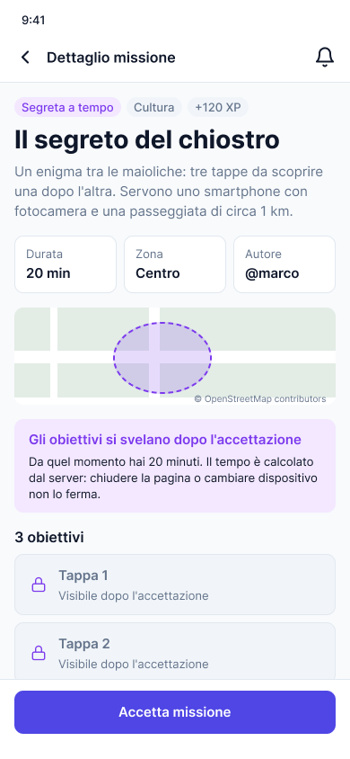<figcaption><b>M1 · Anteprima.</b> Passi 1–3. Obiettivi bloccati, durata e zona approssimativa.</figcaption></figure>
<figure>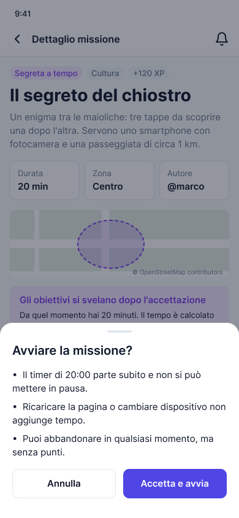<figcaption><b>M2 · Conferma.</b> Passi 4–5 ed estensione 5a. Regole del tempo prima dell'avvio.</figcaption></figure>
<figure>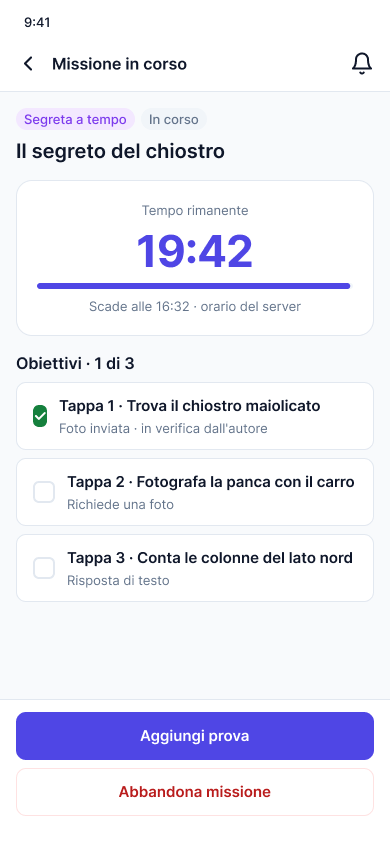<figcaption><b>M3 · Missione in corso.</b> Passo 7 ed estensione 7a. Obiettivi svelati e tempo calcolato dal server.</figcaption></figure>
<figure>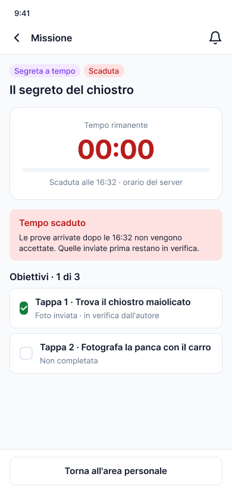<figcaption><b>M4 · Tempo scaduto.</b> Estensione 7b.</figcaption></figure>
<figure>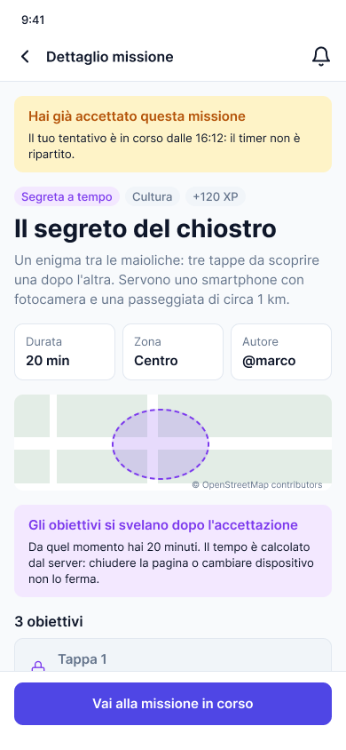<figcaption><b>M5 · Già accettata.</b> Estensione 6a: nessun nuovo timer.</figcaption></figure>
<figure>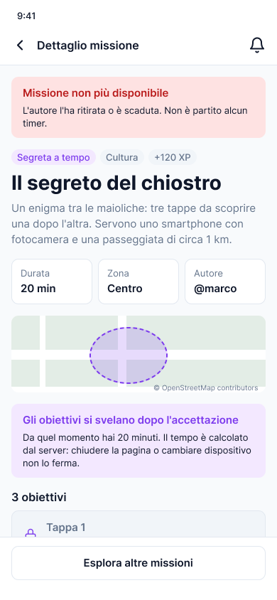<figcaption><b>M6 · Non disponibile.</b> Estensione 6b.</figcaption></figure>
<figure>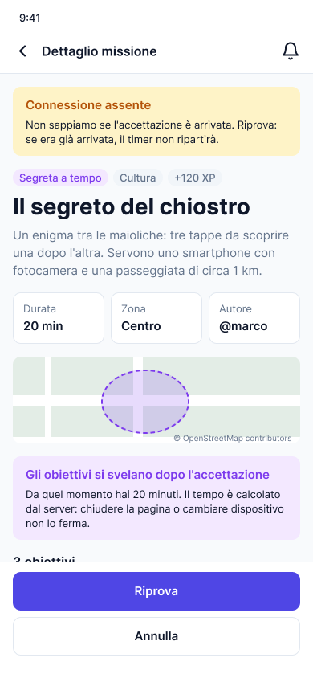<figcaption><b>M7 · Errore di rete.</b> Estensione 6c: riprova senza duplicati.</figcaption></figure>
<figure>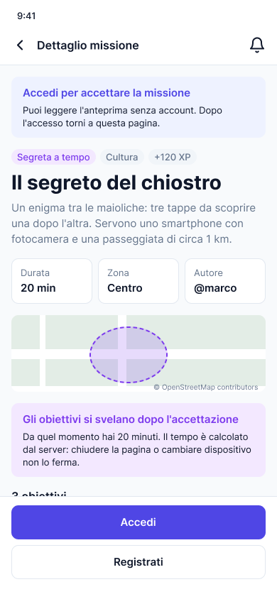<figcaption><b>M8 · Accesso richiesto.</b> Estensione 3a.</figcaption></figure>
</div>
```

# Matrice di tracciabilità

| Requisito | Casi d'uso | RNF | RD | Assunzioni | Formalizzato / mockup |
|---|---|---|---|---|---|
| R01 | UC-01.1 – UC-01.8 | 01, 02, 04, 05 | 09, 12 | A-07, A-15 | — |
| R02 | UC-02.1 – UC-02.5 | 02 | 01, 08 | A-01, A-09, A-24 | — |
| R03 | UC-03.1 – UC-03.4 | 03, 05, 16 | 01, 16 | A-22 | UC-04.1 passi 1–2 (M1) |
| R04 | UC-04, UC-04.1 – UC-04.3 | 03, 06, 07 | 02, 03, 06 | A-02, A-03, A-06, A-22 | **UC-04.1** (M1–M8) |
| R05 | UC-05.1 – UC-05.5 | 07 | 02, 04, 05, 07 | A-03, A-04, A-05, A-08 | — |
| R06 | UC-06.1 – UC-06.3 | 08 | — | — | UC-04.1 passo 6 (notifica all'autore) |
| R16 | UC-16.1, UC-16.2 | 05 | 09, 10 | A-09, A-15, A-16 | — |
| R17 | UC-17.1, UC-17.2 | — | 09, 11 | A-17 | — |
| R18 | UC-18.1 | 05 | 13 | A-18 | — |
| R19 | UC-19.1 – UC-19.4 | — | 14 | A-19, A-20 | — |
| R20 | UC-20.1 – UC-20.3 | 05, 13 | 15, 16 | A-21 | — |
| R21 | UC-21.1, UC-21.2 | 12, 16 | 17 | A-14, A-23 | — |

# Registro delle modifiche

| Versione | Data | Modifica | Motivazione |
|---|---|---|---|
| 1.0 | dicembre 2026 | Prima emissione per la consegna anticipata. | — |

Nella consegna finale questa sezione elencherà le modifiche rispetto alla versione 1.0, con la relativa motivazione (traccia §C.7).

# Appendice · Strumenti utilizzati

- **Diagrammi dei casi d'uso:** PlantUML, sorgenti versionati in `docs/requirements/diagrams/`.
- **Mockup:** Figma, file "SideQuest – Mockup SRS (UC-04)", pagine *Componenti* e *UC-04 Mockup*.
- **Documento:** Markdown compilato in PDF con Pandoc e WeasyPrint (`docs/requirements/build.sh`).
